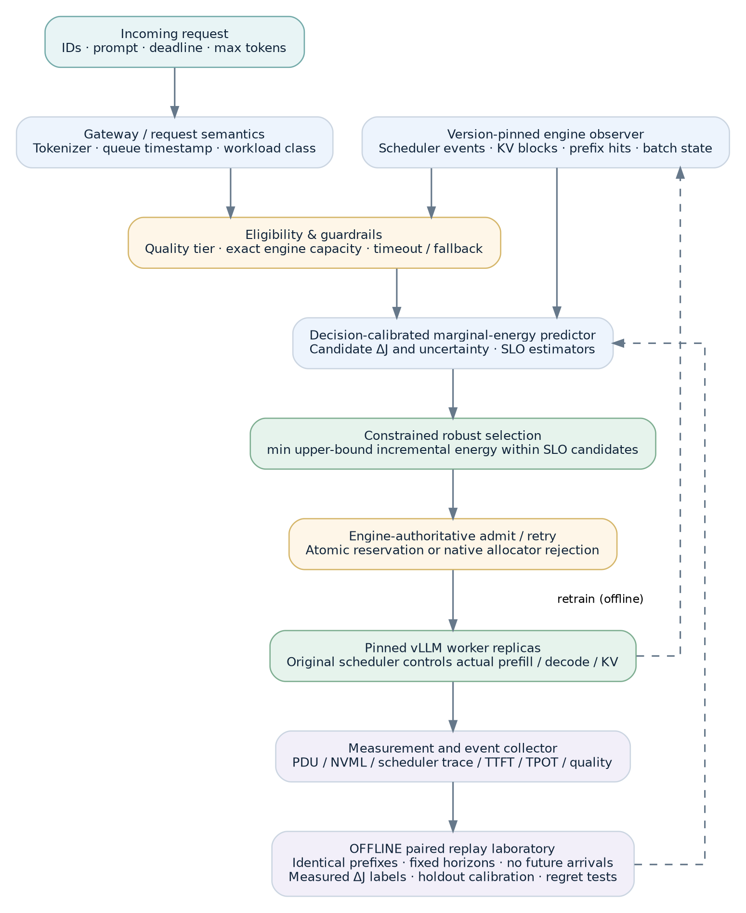

# Executive research decision

**Recommended architecture:** preserve the PIGOU-J research question, but replace the fragile hand-derived, four-stage online GPU trajectory with a **replay-calibrated counterfactual marginal-energy predictor**, supported by a version-pinned serving-engine state interface and engine-authoritative KV admission. Call this design **PIGOU-J v7**. This is an *architecture freeze candidate*, not an experimentally verified system.

**Central hypothesis (H1).** Given identical model weights, serving substrate, quality policy, offered workload, and latency service objectives, a dispatcher trained to estimate *incremental system energy caused by admitting a request at a particular worker and state* can reduce physically measured energy per SLO-compliant output token compared with token-cost, cache-affinity, load-aware, and input-only energy-routing baselines. This claim is **untested**.

**Primary distinction:** an estimate of the energy *difference between two complete executions* is not the same as a request's Shapley billing share or its isolated inference energy. The former is decision-relevant for placement; the latter two are useful accounting or modeling quantities, but need not choose the same worker.

**Research status.** The definitions and elementary theorems below are analytical results under stated assumptions. The offline replay protocol, online predictors, engine hooks, quantitative improvements, and hardware SLOs are proposed designs awaiting implementation and measurement. No percentage improvement, measured latency, physical energy accuracy, or hardware integration is claimed here.

| Decision | Result | Reason |
|:--|:--|:--|
| Preserve | Conditional incremental-energy estimand | Focused, measurable, falsifiable research question |
| Preserve | Signed energy identities and Shapley distinction | Sound algebra, if interpreted narrowly |
| Replace | Hand-coded order-statistic physical scheduler | Cannot reliably reproduce modern engine scheduling, refcounts, chunking, preemption, and KV behavior |
| Replace | Gateway-side exact KV memory accounting | Physical admission must be decided by the engine's allocator |
| Simplify | Lyapunov queue and sparse delayed conformal gate | Not essential to establish the marginal-energy claim; previously created proof/implementation gaps |
| Defer | DVFS, cross-region carbon, prefill/decode disaggregation, semantic caching | Confounds the core experiment and expands instrumentation/quality requirements |
| Require | Paired replay, decision regret, real energy boundary, strong baselines | Converts a conceptual cost into experimentally testable evidence |

# Evidence base and why the design changes

## Project materials reviewed

This synthesis integrates the six attached research artifacts accessible in the project: the 57-page **Energy-Aware LLM Serving Architecture** study; the 35-page **PIGOU-J Final Independent Research Validation & Audit**; the 28-page October verification dossier; the 30-page PIGOU-J consolidated architecture; the 49-page v6.0 pre-experiment dossier; and the 19-page v6.0 correction-and-tests dossier. The historical AER/CORAL/TAEE/CORTEX/MORPH-KV lineage is represented by the analyses in those files. Their stated results are treated as *source claims*, not as independently measured findings.

**AER** correctly motivated cost-quality-energy-aware model selection but depended on static joules-per-token values and numerous controllers. **CORTEX** correctly identified prefill/decode asymmetry and quality/SLO tradeoffs but combined carbon, gating, and queue-control claims beyond its verified assumptions. **MORPH-KV** surfaced the importance of physical KV state and power calibration but conflated retrospective Shapley allocation with prospective incremental energy. **PIGOU-J v1–v6** identified the right counterfactual question yet repeatedly failed at detailed physical-state simulation, engine admission, time indexing, and test-to-code correspondence. The retained intellectual contribution is *the counterfactual placement question*, not the exactness of those particular implementations.

## Independent literature assessment (through 11 November 2026)

Relevant work is already broad. **JouleShare/JCalib** focuses on request-level measured Shapley attribution [1]; **TokenPowerBench** provides phase-aligned energy measurement [2]; **PEARL** and **Measured Joules, Learned Routes** optimize model selection using predicted or measured per-query energy and performance [3,4]. **Festina** makes cluster-level energy-aware placement and resource decisions [5]. **CacheRoute** handles prefix-affinity versus load skew [6]. **Beyond Accuracy and Cost** estimates latency from current prefill/decode activity [7]. **Robust Batch-Level Query Routing** handles capacity and uncertainty [8]. **CEMA-Router** studies infrastructure-aware multi-objective batch routing [9]. **The 1/W Law** emphasizes concurrency, KV capacity, and serving context length [10]. CarbonRouter and carbon-aware live routing are relevant extensions, not a reason to include carbon immediately [11,12].

| Research family | Strongest overlap | What PIGOU-J must demonstrate beyond it |
|:--|:--|:--|
| JouleShare / Shapley attribution | Replayed batch energy; fairness allocation | Decision value of **incremental admission** rather than fair allocation |
| PEARL / Measured Joules | Energy-aware heterogeneous model routing | **Live worker state** and interference-sensitive energy labels |
| Festina / CEMA-Router | Energy-aware placement, hardware or batch coordination | A controlled demonstration of **paired counterfactual ranking**, holding other actuators fixed |
| CacheRoute | Prefix reuse versus imbalance | Physical joules gained by cache reuse **relative to queue/batch interference** |
| Latency-aware routing [7] | Engine state and simulated batching | Physical energy boundary, paired energy labels, energy-regret evaluation |
| Robust batch routing / 1/W law | Capacity, uncertainty, context-concurrency | Engine-authoritative capacity **plus** calibrated incremental-energy decisions |

**Novelty position, intentionally bounded.** We do **not** claim first energy-aware router, first cache-aware router, first counterfactual simulator, or first use of GPU telemetry. The candidate contribution is an end-to-end method that **(i)** constructs *measured paired counterfactual admission-energy labels* under continuous-batching serving, **(ii)** learns and uncertainty-calibrates a fast *state-conditional* placement score against those labels, and **(iii)** demonstrates *decision regret* and real serving-energy benefits under matched capacity/quality/SLO constraints. Priority and publishability depend on the eventual literature-complete comparisons and measured results.

# Final architecture

{width=4.6in}

The production path is short: request semantics; engine-observed state; tier and capacity guard; candidate incremental-energy and SLO prediction; robust candidate selection; **engine-authoritative** admission; physical telemetry. The expensive offline loop replays matched state prefixes twice (without/with candidate admission) and produces training and holdout labels. It never forks a live CUDA context.

## Modules and their contracts

| Module | Required input | Output and fallback |
|:--|:--|:--|
| M0. Request interface | Token IDs, model compatibility, max output tokens, arrival time, SLO class | Immutable request descriptor; reject incompatible model |
| M1. Engine-state observer | Running/waiting requests, scheduler budget, KV block availability, actual prefix-hit result, preemption state, clock/temperature | Versioned snapshot with timestamp and uncertainty; conservative fallback when stale |
| M2. Quality eligibility | Offline quality estimates, task class, supported model tier | Allowed model tiers; unknown class goes to high-capability default (not a factual safety guarantee) |
| M3. Capacity gate | Engine's true allocation and admission logic | Candidate can be tentatively considered; **actual allocation must still be accepted inside engine** |
| M4. Marginal-energy scorer | Request, current worker features, offline-trained model, uncertainty | Estimated incremental J and interval; cannot invent physically exact KV fields |
| M5. Latency-risk estimator | Queue and batch state, request features | Predicted TTFT and TPOT distributions; conservative fallback on OOD states |
| M6. Constrained selector | Eligible candidates, predicted energy and latency, uncertainty, policy limits | Lowest robust feasible energy score; if no candidate, queue/reject/defer |
| M7. Engine admission | Chosen worker, immutable request, engine epoch/state | Atomic success or capacity rejection; retry with fresh state; never silently force-dispatch |
| M8. Evidence collector | Engine scheduling events, PDU/NVML energy, timings, output and audit labels | Immutable traces, experiment IDs, quality/rejection ledger |
| M9. Offline replay lab | Recorded request prefix, admission intervention, fixed workload/seed/horizon | Paired measured energy deltas and uncertainties; frozen train/validation/test splits |

## Serving-engine choice

Use one pinned **vLLM V1** version for the first implementation; later portability to SGLang is a separate experiment. vLLM V1 explicitly supports chunked prefill and prefix caching with a unified scheduler [13]. Its KV cache manager tracks computed prefix blocks and performs allocation subject to scheduler/allocator behavior, including facilities for full-sequence-fit checking [14,15]. These are **internal engine methods**, not a promised stable public remote atomic reservation API. Implement a minimal version-pinned engine-side admission adapter or use the native scheduler's authoritative rejection semantics; do not imitate exact refcounts with a gateway hash mirror.

Start with **homogeneous replicas of one model** to isolate placement energy. After passing the energy-estimator falsification test, add a heterogeneous small/large model pool behind an independently evaluated quality gate. Keep model weights, GPU clocks, quantization, batching parameters, speculative decoding, and maximum context fixed within each causal comparison. Disaggregated P/D and DVFS are off in the initial study.

# Mathematical target and counterfactual semantics

## State, action, and energy boundary

At decision time $t$, let $S_t$ denote the complete *realized* serving state over the chosen physical boundary: scheduled/waiting requests, KV allocation and prefix cache, worker/model identity, scheduler configuration, utilization and thermal state. Let $r$ denote an arriving request, and $a=w$ mean admit to worker $w$. Let $a=\varnothing$ mean omit this request for the local counterfactual, **not** reject it in the deployed service.

Let $\mathcal A_{<t}$ be the recorded offered workload and admissions before $t$. In the **isolation experiment**, replay the exact same prefix $\mathcal A_{<t}$, reach a matching state fingerprint, apply one candidate action, and freeze *new arrivals after $t$* for both arms. Use the same scheduler configuration and a **common horizon** $H$ long enough to drain both finite workloads. If either arm fails to drain, mark the pair censored; do not invent an oracle delta.

For measured whole-node input power $P^a_{\mathrm{AC}}(u)$ when a PDU is available, define:

$$
E_{\mathrm{AC}}^{a}(S_t;H)=\int_0^{H}P_{\mathrm{AC}}^{a}(u)\,du,
\qquad
\Delta E_w(S_t,r;H)=E^{w}(S_t;H)-E^{\varnothing}(S_t;H).
\tag{1}
$$

The corresponding **subsystem** estimand may use GPU board plus measured host CPU/DRAM energy if the AC meter is unavailable; it must be named differently and cannot support a whole-node electricity claim. Summing NVML and RAPL is appropriate only for independently checked non-overlapping sensor domains, and never in addition to the PDU energy as if they were separate energy costs. Routing-process and shadow-audit energy fall inside the primary boundary when run on in-scope machines.

The common horizon makes the exact fixed idle baseline cancel:

$$
\Delta E_w=\int_0^H \big(P_w^+(u)-P_w^0(u)\big)\,du.
\tag{2}
$$

**Critical nuance:** the *definition* is exact for actual measured paired executions; an estimator based on predictive models and logged approximate state is not physically exact. $\Delta E_w$ can be negative due to consolidation/savings. Never clip signed differences.

For the initial scientific question, $\Delta E_w$ is **open-loop, no-future-arrivals, finite-horizon admission cost**. For the real routing experiment, new traffic continues to arrive and subsequent decisions interact. Therefore local regret results do **not** prove global infinite-horizon optimality; the latter must be tested end to end.

## Energy externality is an interaction, not a unique invoice

The primary optimization uses the **total** marginal energy in (1), avoiding arbitrary separation. If an explanatory decomposition is wanted, define a reference solo-energy value $E_{\mathrm{solo}}(r\mid S_t)$ under an explicit matched warm-cache convention and let:

$$
\Delta E_w=E_{\mathrm{solo}}(r\mid S_t)+ E_{\mathrm{interact}}(r,B_w\mid S_t),
\quad E_{\mathrm{interact}}:=\Delta E_w-E_{\mathrm{solo}}.
\tag{3}
$$

This is an **accounting definition**, not a physical conservation law assigning unique watts to particular incumbents. It can be positive or negative. Do not relabel the two terms as universally identifiable “private” and “external” energies. The source of the estimate is the **difference of complete scenario energy**, including any pause, replay, eviction, prefix reuse, idle tail, or future incumbent work.

## Why complete scenario replay replaces the four-stage formula

A four-stage analytic approximation omits key behaviors that modern serving engines can perform: interleaved mixed-token scheduler steps, preemption/recomputation, capacity-adaptive chunking, nontrivial shared block refcounts, speculative token lookahead, and state-dependent throughput. Instead, define one model of total *scheduler event sequences* $\Gamma(S_t,a;\theta)$ and predict:

$$
\widehat{\Delta E}_w
=\widehat E\big(\Gamma(S_t,w;\theta)\big)
-\widehat E\big(\Gamma(S_t,\varnothing;\theta)\big).
\tag{4}
$$

The offline reference derives $\Gamma$ from an instrumented engine trace or CPU replay **of the pinned engine's actual scheduler semantics**, not an invented batch trajectory. A phase-aware power model can be retained as a secondary explanatory estimator:

$$
\widehat E(\Gamma)=P_{\mathrm{idle}}H+
\sum_{k}\left[\widehat P_{\mathrm{total}}(z_k)-P_{\mathrm{idle}}\right]\Delta t_k.
\tag{5}
$$

Here $z_k$ is the actual or simulated scheduler-step feature vector; $\widehat P_{\mathrm{total}}$ is **total** GPU-board power. If one instead fits excess-active power, omit the extra $-P_{\mathrm{idle}}$ inside the sum. The $\Delta t_k$ cover non-overlapping elapsed intervals. Validate (5) on held-out measurement windows; do not presume a 2% closure error.

For online speed, the preferred path is a **direct learned predictor of paired $\Delta E_w$** from request and observed worker state. The event simulator is an offline teacher/diagnostic, not a production-critical CPU replay on every request. Compare its rankings with the direct learner. Keep both if they are complementary; do not mix their claimed accuracy.

# Offline paired-replay experimental laboratory

## Constructing the labels without live GPU forking

For each selected historical prefix and candidate worker $w$:

1. Reset the serving worker to a documented cold or warm starting condition; load the same model and prime the same cache as specified by the prefix.
2. Replay all requests before $t$ with identical arrival timestamps, normalized prompts, output-length constraints, sampling configuration, and per-request seeds. Record a **state fingerprint** before the intervention: active request IDs, generated-token counts, engine KV allocator summary, cache epoch/hits, queue order, clocks and temperature range.
3. Arm 0: omit $r$ at $t$ and drain, with **no further arrivals**, under the fixed horizon $H$.
4. Reset and replay the same prefix again; Arm $w$: admit $r$ to $w$ at $t$, freeze future arrivals, and drain under the same $H$.
5. Integrate physical energy over identical boundaries; repeat and randomize arm order to control drift. Report the paired difference, run variance, and whether state fingerprints matched within a prespecified tolerance.
6. If action $w$ violates engine feasibility at $t$, label it **infeasible**, not high-energy. Do not train the scorer to rank impossible actions.

Do not use OS process forking of a running CUDA context as a physical counterfactual. Do not use zero future arrivals in the replay and then claim the estimator is globally optimal under future stochastic arrivals. As an additional robustness set, replay **identical exogenous future offered arrivals** in both arms under a frozen downstream routing policy; report this as a different estimand.

### Treatment of generation randomness

For the first *scheduler-interference* study, fix each request's desired output length within a finite cap and use per-request deterministic generation/sampling controls as far as the engine permits. Separately repeat with natural EOS stopping. Matched seeds do not prove perfectly identical token trajectories across GPU schedules or nondeterministic kernels. Record any divergence and quantify its contribution to paired noise. The replay label is a noisy empirical reference, not a metaphysically exact “fork” of live execution.

## Replay label and uncertainty

For $R$ paired replicates with randomized order, estimate

$$
\overline{\Delta E}_w=\frac{1}{R}\sum_{j=1}^R\left(E^{(j)}_{w}-E^{(j)}_{\varnothing}\right),
\qquad
\widehat{\mathrm{SE}}_w=\frac{\mathrm{SD}(E^{(j)}_{w}-E^{(j)}_{\varnothing})}{\sqrt R}.
\tag{6}
$$

The paired variability, not A/A baseline variability alone, determines confidence and statistical power. Do not use a fixed assumed 25% variance inflation as measured evidence. Stratify prefixes by load, prompt length, output length, candidate cache reuse, model tier, and KV pressure; hold out entire arrival traces or sessions to prevent leak. Include deliberately adverse cases with zero cache hits, high load, heterogeneous residual lengths, nearly full KV, cold-to-active transition, and cache evictions.

# State-conditioned incremental-energy learner

## Feature contract

Only feed data available **before admission** to the online learner. Candidate features include tokenized prompt length, conservative output maximum and predicted output-length quantiles, queue/prefill budget, currently running and waiting sequences, allocated/free KV blocks from the pinned engine, verified candidate prefix-hit count, recent phase distribution, actual GPU board-power statistics, clocks, memory usage, and a freshness/confidence bit for every sensor. Keep **SLO predictions** separate from energy-target prediction so a poor latency estimate can be audited independently.

For each feasible candidate, train $f_\theta(x_r,S_w)\to\widehat{\Delta E}_w$ using matched paired labels (6). A practical first model is histogram-based gradient-boosted trees; compare against linear and power-surface models. Add a rank-oriented auxiliary loss emphasizing candidate pairs with material measured energy differences:

$$
\mathcal L(\theta)=\sum_i\rho\big(f_\theta(x_i)-y_i\big)
+\lambda_{\mathrm{rank}}\sum_{(i,j)}a_{ij}
\log\!\left[1+\exp\!\left(-\frac{s_{ij}(f_\theta(x_j)-f_\theta(x_i))}{T_0}\right)\right],
\tag{7}
$$

where $y_i$ is the measured delta, $\rho$ is a robust regression loss, $s_{ij}=\mathrm{sign}(y_j-y_i)$ for **the same request/state and distinct candidate workers**, and $a_{ij}$ emphasizes clearly separated pairs. This auxiliary loss is a *design proposal*, not a verified performance improvement; compare against pure delta regression in an ablation.

## Uncertainty and robust candidate selection

Using held-out traces, form nonnegative error margins $u_w(x,S)$, stratified where data permit; define estimated upper cost $U_w=\widehat{\Delta E}_w+u_w$. Those intervals are **empirically calibrated under the holdout distribution**; do not claim distribution-free coverage under arbitrary workload drift.

Let $\widehat{\Pr}(\mathrm{TTFT}_w>L_T)$ and $\widehat{\Pr}(\mathrm{TPOT}_w>L_D)$ be separately validated latency-risk predictors. Define the *model-predicted* feasible set:

$$
\widehat{\mathcal F}(r,S)=\left\{w:\ 
\begin{array}{l}
\text{quality tier eligible};\ \text{engine admission can be attempted};\\
\widehat{\Pr}(\mathrm{TTFT}_w>L_T)\le\epsilon_T;\quad
\widehat{\Pr}(\mathrm{TPOT}_w>L_D)\le\epsilon_D
\end{array}\right\}.
\tag{8}
$$

Route by **robust constrained energy**, not a dimensionally delicate dual-queue hybrid:

$$
\widehat w=\arg\min_{w\in\widehat{\mathcal F}(r,S)}
\bigl[\widehat{\Delta E}_w+u_w+\widehat E_{\mathrm{gateway}}(w)\bigr].
\tag{9}
$$

The gateway term is included only when it changes materially by destination; shared gateway work is counted in the physical endpoint regardless. Infeasible or stale-state candidates are excluded or sent to a conservative queue/load-aware fallback. A predicted SLO constraint is **not a formal SLO guarantee**. Keep rejection, queueing, and fallback outcomes in every comparison. If maximizing true success-weighted quality becomes necessary, formulate it as a separate constrained extension after the homogeneous energy experiment.

# Safe admission, caching and fallback

**The engine owns physical KV memory.** Use a version-pinned adapter for engine-side feasibility/admission decisions, not a gateway approximation of how 16-token blocks and prefix cache refcounts work. The adapter must understand cache groups, prefix hit eligibility, any sliding window, token lookahead/speculative slots, maximum model length, and the engine's native scheduler admission semantics. Record its exact code hash and version. An HTTP `/metrics` scrape is not an atomic reserve operation.

The gateway computes rankings from its *snapshot* but final allocation is conditional on an engine-authoritative accept. A two-phase **try-admit/commit** mechanism is a required integration contract, not a claim that current vLLM exposes that exact remote function. If the engine rejects or the epoch changes, re-read state and try another eligible worker; after a bounded retry count, queue or reject safely. Never choose a worker that the engine has rejected to preserve a “fallback” path.

**Capacity budgeting:** a request's configured $\texttt{max\_tokens}$ is a *hard serving limit* for admission safety; a predicted output-length quantile may help rank costs but must not silently replace the engine's maximum allocation policy. Where current vLLM allocates incrementally rather than reserves a full sequence, its native preemption/admission rules are authoritative. If strict no-preemption reservations are required, build and validate an engine-side admission policy, then account for the lost packing efficiency in ablations.

**Quality gate:** phase 1 uses one model so quality differences between replicas disappear. In phase 2, permit small models only for task families with offline evaluated capability and clearly stated label definitions. Unknown/OOD task classes go to the larger tier. Optionally use randomized shadow audits to estimate **comparative regression** on actual traffic; do not revive the previous distribution-free “always safe” claims without a separate verified implementation and feedback theory. Audit GPU costs must enter measured total energy.

# Four analytical results and proofs

## Theorem 1: exactness of the fixed-horizon energy difference

**Statement.** Let baseline and intervention executions be measured on the same set of physical devices, from matching initial conditions, over one common $H$, with total input power $P^0(t),P^w(t)$ integrable. If $P_{\mathrm{idle}}$ is the same in both arms, then

$$
E^w-E^0=\int_0^H\big(P^w(t)-P^0(t)\big)dt.
\tag{10}
$$

Furthermore, for arbitrary real step powers and durations,

$$
P^+\tau^+-P^0\tau^0=(P^+-P^0)\tau^0+P^+(\tau^+-\tau^0).
\tag{11}
$$

**Proof.** Equation (10) follows from linearity of integration: subtract the two integrals over identical boundaries and intervals. Any identical constant idle component integrates to $P_{\mathrm{idle}}H$ in both and cancels. Equation (11) follows by adding and subtracting $P^+\tau^0$; no monotonicity or positivity assumption is used. $\square$

**Scope.** These are algebraic statements, not proofs of physical power-model accuracy, phase decomposition uniqueness, or causal equivalence if the initial conditions are not matched.

## Theorem 2: Shapley attribution is not generally incremental dispatch cost

Let $E:2^N\to\mathbb R$ with $E(\varnothing)=0$. For a newcomer $i$ and incumbent set $B$, the marginal cost is $\Delta_i(B)=E(B\cup\{i\})-E(B)$. The Shapley value averages $\Delta_i(S)$ across subsets $S\subseteq B$ with weights $|S|!(|B|-|S|)!/(|B|+1)!$.

**Statement.** The Shapley share $\phi_i(T)$ equals $E(T)-E(T\setminus\{i\})$ for **every** nonempty coalition $T$ and every $i\in T$ if and only if $E$ is additive. Moreover, non-additive energy functions can reverse worker preferences between these two objectives.

**Proof (equivalence).** If $E$ is additive, each marginal contribution equals $E(\{i\})$, so its weighted average equals the full marginal. Conversely, suppose the equality holds for all $T,i$. Shapley efficiency gives $\sum_{i\in T}\phi_i(T)=E(T)$. Substituting full marginals yields $(|T|-1)E(T)=\sum_{i\in T}E(T\setminus\{i\})$. By induction on $|T|$, the RHS equals $(|T|-1)\sum_{i\in T}E(\{i\})$; divide for $|T|\ge2$. The singleton case is immediate. Hence $E$ is additive. $\square$

**Constructive rank reversal.** For an already-active worker $w$ define $E_w(S)=120\,\mathbf1[S\ne\varnothing]+\sum_{j\in S}e_{wj}$ (joules). Suppose newcomer incremental costs are $e_{1r}=9$ and $e_{2r}=15$, with one incumbent on $w_1$ and four on $w_2$. Their **actual incremental** costs are 9 J and 15 J, so marginal routing chooses $w_1$. Shapley charges the newcomer $9+120/2=69$ J on $w_1$, versus $15+120/5=39$ J on $w_2$, so Shapley routing chooses $w_2$. For this toy system that wastes 6 J of additional energy. The result establishes possibility, not the frequency of such behavior on real GPUs.

## Theorem 3: conditional decision-regret bound for a learned score

**Statement.** On one request and fixed state, let the *true* feasible candidate set be $\mathcal F$ and let the candidate costs be $J_w$. Suppose the scoring algorithm uses the same $\mathcal F$ and its estimates satisfy $|\widehat J_w-J_w|\le\varepsilon$ for every $w\in\mathcal F$. Let $\widehat w=\arg\min\widehat J_w$, $w^*=\arg\min J_w$. Then

$$
0\le J_{\widehat w}-J_{w^*}\le2\varepsilon.
\tag{12}
$$

**Proof.** From uniform prediction error, $J_{\widehat w}\le\widehat J_{\widehat w}+\varepsilon$. From estimated optimality, $\widehat J_{\widehat w}\le\widehat J_{w^*}$. Again from uniform error, $\widehat J_{w^*}\le J_{w^*}+\varepsilon$. Chain these three inequalities. $\square$

**Upper-confidence variant.** If for every feasible $w$, $J_w\in[\widehat J_w-u_w,\widehat J_w+u_w]$ and $\widehat w$ minimizes $\widehat J_w+u_w$, then $J_{\widehat w}-J_{w^*}\le2u_{w^*}$. The same chain proves the result. This theorem is conditional on valid simultaneous intervals and on the optimizer's true feasible worker appearing in the considered set. It does **not** imply a bound on global multi-arrival energy, confidence under distribution shift, or safety of a misspecified SLO model.

## Theorem 4: engine-reservation capacity invariant

**Statement.** Consider an allocator with $K$ physical blocks available to a worker, tracking reservations $b_r\ge0$ for active admitted requests. Assume (i) each accepted admission checks and increments $\sum_r b_r$ **atomically** against $K$, (ii) a request never consumes more than its granted reservation, and (iii) releases never increase outstanding reservations. Then the worker cannot consume more than $K$ reserved blocks.

**Proof.** Initially $\sum_r b_r=0\le K$. By induction, an admission either rejects without changing the sum, or atomically accepts only when the new sum is at most $K$. Releases reduce the sum. Actual consumption is no greater than each reservation, so total consumption is at most $\sum_r b_r\le K$. $\square$

**Scope.** This is a proof about the **contract**, not a proof that vLLM already provides this remote reservation API. Any extra cache group, speculative lookahead, shared-block reference semantics, or preemption invalidating assumption (ii) must be handled by the native allocator or the instrumentation-specific policy.

# Quality control without false conformal guarantees

Define a potential comparative error $Z_t=A_t\mathbf1\{\text{small wrong, large correct}\}\in\{0,1\}$, where $A_t$ is the actual small-tier dispatch indicator. Let audit sampling $I_t\sim\mathrm{Bernoulli}(p_t)$ be drawn *after* $A_t$ and independently of the potential correctness label conditional on history, with $p_t\ge p_{\min}>0$. Define $\widehat Z_t=I_t Z_t/p_t$ for fully resolved audits. Then

$$
\mathbb E[\widehat Z_t\mid Z_t,\mathcal H_t]=Z_t.
\tag{13}
$$

For a prespecified **fixed** horizon $T$, conditional martingale Hoeffding gives, with probability at least $1-\delta$,

$$
\frac1T\sum_{t=1}^T Z_t\le
\frac1T\sum_{t=1}^T\widehat Z_t+
\frac1{p_{\min}}\sqrt{\frac{\log(1/\delta)}{2T}}.
\tag{14}
$$

**Proof sketch.** The difference $D_t=Z_t-\widehat Z_t$ is a martingale difference by (13). Conditional on $Z_t$, its range has length at most $1/p_t\le1/p_{\min}$. Hoeffding's exponential lemma and a standard Chernoff bound yield $\Pr(\sum_tD_t\ge\eta)\le\exp(-2p_{\min}^2\eta^2/T)$. Set $\eta=\sqrt{T\log(1/\delta)/(2p_{\min}^2)}$ and divide by $T$. $\square$

**Important limitations.** This is a **retrospective confidence bound on comparative-error rate**, not a guarantee that the online gate keeps error below a target $\alpha$. It assumes a meaningful ground-truth comparison, unbiased audit inclusion, and resolved labels. For unresolved audited steps, count the maximum $I_tA_t/p_t$ in a conservative upper estimator; for optional continuously monitored prefixes use a confidence sequence or a correctly allocated union bound, not (14) at unadjusted $\delta$ on every prefix. Even a large model can be factually wrong; comparative quality is not absolute correctness. The initial homogeneous energy experiment needs no such quality gate.

# Online dispatch algorithm and failures

```text
on_request(r):
  x = tokenize_and_validate(r)
  S = get_engine_snapshots_with_epoch()
  tiers = quality_policy.allowed_tiers(x)  # homogeneous first
  candidates = []
  for worker in workers_in(tiers):
      if snapshot_stale(worker):
          continue
      if not engine_adapter.can_attempt_admission(worker, x, max_tokens=r.max_tokens):
          continue
      e_hat, u = marginal_energy_model.predict(worker, S, x)
      ttft_risk, tpot_risk = latency_model.predict(worker, S, x)
      if ttft_risk <= eps_T and tpot_risk <= eps_D:
          candidates.append((e_hat + u + gateway_increment(worker), worker))
  for worker in candidates_sorted_by_score(candidates)[:MAX_RETRIES]:
      outcome = engine_adapter.try_admit(worker, x, expected_epoch=S[worker].epoch)
      if outcome == ACCEPTED:
          record_decision_and_measurement_tags(r, worker, S)
          return worker
      S[worker] = refresh_snapshot(worker)
  # If predicted SLO-feasible set is empty, use pre-registered conservative
  # load-aware/queueing policy that STILL must pass engine admission.
  return hold_or_reject_with_explicit_ledger(r)
```

**Critical safety properties:** no direct mutation of internal engine block tables from the gateway; no fallback dispatch that bypasses native engine admission; no assertions of exact cache hits from an unsynchronized mirror; no silent dropping of rejected requests from quality/SLO/energy metrics. If snapshots are stale, fall back to a safe *load-aware* selector and record how often this happens. Benchmark fallback overhead against the intended predicted savings.

# Measurement, controls, and falsification

## Physical energy endpoint

When high-resolution calibrated PDU metering is available, the **primary** endpoint should be **cluster AC joules per 1,000 SLO-compliant generated output tokens** under an identical offered trace and common fixed measurement horizon. Include inactive-node idle power, gateway, all worker replicas, node fans and PSU losses inside the metered boundary, and in-boundary shadow-audit energy. External facility cooling is not counted unless independently included in the measurement boundary. Do not charge PDU watts again on top of NVML. Secondary GPU energy uses cumulative NVML counters where supported [16]. CPU/DRAM RAPL can be a diagnostic component when its hardware domains and overlap are verified. If no PDU exists, explicitly downgrade the endpoint to the measured subsystem boundary and qualify conclusions.

Define per-run ratio $Y_s=1000 E_{\mathrm{measured,s}}/G_s$ for $G_s>0$ SLO-compliant output tokens. Report **absolute** energy, completed requests, SLO attainment, rejection rate, goodput and throughput alongside $Y_s$; a policy that rejects traffic cannot masquerade as energy-efficient. Use full-run ratios for paired differences, not token-level pseudo-replicates.

Measure TTFT from arrival to first delivered token; TPOT from output inter-token intervals under the engine's published convention, taking care with one-token outputs. Report P50/P95/P99 with independent run-level uncertainty and per-request quality where a comparable label exists. Router CPU utilization and latency must be included in the system endpoint.

## Experimental stages

| Stage / gate | What must be measured | Pass condition (defined before looking at outcomes) |
|:--|:--|:--|
| 0. Integration preflight | GPU/CPU/PDU sensor support; engine version/hash; reject/epoch hooks; trace consistency | Real counter increments, coherent clocks, controlled rejection; instrumentation overhead quantified |
| 1. Physical calibration | Held-out step-power energy versus NVML; PDU vs DC diagnostics | Errors and uncertainty inside pre-registered tolerances; no arbitrary 2% promise |
| 2. Paired counterfactual dataset | Prefix-matched $E^w-E^0$ with multiple worker choices, randomized arm order | Replay-state reproducibility, physically distinguishable deltas, sufficiently low paired noise |
| 3. Decision-focused falsification | Prediction MAE, sign/rank accuracy, regret against replay oracle | Beats strongest energy-only heuristic on **held-out traces** with uncertainty interval |
| 4. Homogeneous routing pilot | Four or more same-model replicas, varied offered rate and cache reuse | Lower AC or subsystem J/goodput than best comparable baseline, non-inferior SLO and rejection |
| 5. Confirmatory generalization | Fresh seeds/traces, long context, heterogeneous output lengths, alternative GPU/model | Prespecified effect and uncertainty after multiple-comparison correction |
| 6. Optional quality tiers | Ground-truth large/small capability, audit energy, shift | No unsupported quality-risk claim; end-to-end physical improvements after audit cost |

**Falsification, not compulsory success:** abandon or substantially narrow the hypothesis if the paired delta is too noisy to rank workers, if rankings do not outperform simpler queue/cache features, if router and instrumentation overhead erase energy savings, or if SLO quality/rejection deteriorates. A negative result is scientifically informative.

## Fair baselines and ablations

For homogeneous stage: random or round-robin; shortest queue/inflight tokens; prefix-affinity; cache-aware + queue-aware; phase-aware power/latency heuristic; and a latency-state estimator inspired by [7]. For the more expensive heterogeneous stage: add PEARL-style input-only energy model [3], Measured Joules-like input router [4], robust batch routing [8], and a quality-matched highest-capability baseline. Shapley/JCalib [1] is best treated as an **attribution-vs-decision diagnostic** unless an authentic dispatch implementation is available; do not misrepresent an ex-post oracle as a deployable real-time baseline. Include Festina-style placement/consolidation only in a separately controlled comparison, since its DVFS/resource adaptations are different actuators.

Core ablations: (a) no worker-state features, (b) no prefix-hit feature, (c) token-proportional energy, (d) no uncertainty penalty, (e) no decision-ranking loss, (f) synthetic power surfaces versus measured paired labels, (g) stale versus fresh state, (h) routing overhead excluded versus included, and (i) short-context versus long-context pool. Retain the same engine, model, and hardware configuration when claiming causal attribution to routing alone.

## Statistical design

Choose **paired independent workload seeds** as the unit of replication. Pair policy runs by exogenous request trace; randomize execution order and interleave A/A controls; isolate thermal/time-of-day drift. Use a pilot to estimate the actual standard deviation of paired effects, then fix the number of **fresh confirmatory** seeds based on the pre-registered effect size, power target, multiplicity and analysis method. Do not reuse a screening set as confirmatory evidence without a valid adaptive design.

For the headline comparison, test *policy minus best prespecified baseline* for full-run AC J/goodput with a confidence interval and a practical-effect threshold. If signed-rank analysis is selected, handle ties and zeros in accordance with the pinned SciPy version; an “exact” option is not automatically exact with ties/zeros. Pre-register whether the inferential statistic is paired percentage change, paired absolute ratio difference, or log ratio; do not switch after inspection. Report separate confidence intervals for SLO attainment and capacity rejection. Adjust family-wise error across the prespecified primary contrasts and regimes.

# Implementation plan, resource constraints, and responsible scope

**Fastest credible MVP:** same model on **two physical replicas** with comparable GPUs and a working whole-node meter or NVML counters. Begin with a stable fixed-batch/scheduler configuration, then add controlled continuous batching. Expand to four replicas only after paired replay and the state hooks work. The initial marginal-cost phenomenon does **not** require a 72B model, multi-node disaggregation, online RL, or real-time carbon APIs.

Recommended stack: vLLM V1 pinned to a commit; Python gateway/FastAPI for research control with worker-local engine adapters; PyTorch model as served workload; LightGBM or XGBoost for the CPU-side cost predictor; Polars/Pandas + Parquet for immutable traces; Python `pynvml` or NVML C binding for GPU energy; site PDU for AC input when available; Prometheus for aggregate observability; pytest/property-based testing; SciPy/statsmodels for paired inference. Rust/Go gateway optimization is an optional engineering step **only if** measured Python critical-path overhead is problematic.

| Work package | Concrete acceptance artifact | Blocking risk |
|:--|:--|:--|
| Engine capability audit | Pinned commit, reproducible state inspection, admission semantics | Internal APIs change; unaudited cache semantics |
| Energy collection | Sensor trace, cross-check, boundary diagram, synchronized clocks | Incompatible NVML hardware, sampling aliasing, PDU absence |
| Replay lab | Two-arm match logs, fixed horizon, repeatability plots | Unable to reconstruct equivalent scheduler/KV state |
| Direct delta learner | Trained model, held-out ranking/regret curves | Labels too noisy or inadequate state features |
| Router | End-to-end SLO, retries, no false capacity commits | Race between snapshot and engine scheduling |
| Controlled pilot | Complete baseline comparisons and cost-of-router measurement | No measurable savings after overhead |

**Non-goals for the primary paper:** geographic carbon arbitrage, claimed zero-carbon curtailment, online bandit exploration, federated semantic cache, hand-built KV refcount emulation, universally valid conformal correctness certification, and automatic DVFS. These can be independently studied after a successful incremental-energy result. If carbon is added later, use $\Delta C=\int \mathrm{MOER}(u)\,\Delta P(u)du$ with a traceable grid signal and state the geographic/time boundary; joules alone do not imply carbon reductions.

# Proof/verification ledger and exact current readiness

Eight reference checks were executed locally using the attached `PIGOUJ_math_checks.py`: signed bilinear identity (20,000 numerical samples), additive Shapley equality, wake-up rank reversal, $2\varepsilon$ regret bound (20,000 randomized cases), unbiased Bernoulli audit estimator (exhaustive audit subsets in a toy case), abstract atomic reservation invariant (2,000 operations), common-horizon idle cancellation, and the possibility of signed-negative marginal energy. **All eight passed.** This supports the arithmetic and isolated proofs; it does **not** test vLLM admission, stochastic scheduling, GPU replay fidelity, quality labels, or measured savings.

| Claim | Evidence now | Readiness |
|:--|:--|:--|
| Exact signed algebra and finite differences | Symbolic reasoning + passed numerical regression | Analytically sound |
| Shapley vs marginal cost distinction | Inductive proof + explicit counterexample | Analytically sound |
| Uniform-error $2\varepsilon$ local regret | Elementary proof + randomized test | Conditional theorem |
| Reservation prevents KV overuse | Induction under atomic native-reservation assumptions | Conditional theorem; API/integration not yet shown |
| Bernoulli shadow-audit unbiasedness | Conditional derivation + toy enumeration | Retrospective bound only |
| Replay-estimated joules track physical intervention | **No hardware measurements** | Unverified |
| Learning improves decision regret | **No trained model or held-out study** | Unverified |
| End-to-end energy savings | **No GPU routing experiment** | Unverified |
| SLO compliance / quality | **No engine integration or benchmark** | Unverified |
| “First”/unique priority | Closest relevant literature surveyed, not a priority proof | Unestablished |

**Current decision: GO for a *bounded engineering feasibility and telemetry smoke test*, not GO for the full routing or confirmatory experiment.** Before a controlled online routing pilot, the engine state/admission adapter, replay-state matching, held-out energy labels, and a tested fail-safe must exist. A top-tier research submission requires measured results, strongest-baseline comparisons, uncertainty intervals, and full reproducibility artifacts.

# Sources and provenance

## Current primary / official external references

1. Qi Luo et al. (2026), **Request-Level Energy Attribution for Batched LLM Serving (JouleShare/JCalib)**. [arXiv:2608.00026](https://arxiv.org/abs/2608.00026).
2. Chenxu Niu et al. (2025/2026), **TokenPowerBench: Benchmarking the Power Consumption of LLM Inference**. [arXiv:2512.03024](https://arxiv.org/abs/2512.03024).
3. Kouider Chadli, Goetz Botterweck, and Takfarinas Saber (2026), **PEARL: Performance and Energy Aware Routing for LLMs**. *Future Generation Computer Systems* 176, 108218. [DOI:10.1016/j.future.2025.108218](https://doi.org/10.1016/j.future.2025.108218).
4. Muhammad Abdur Rab Siddiqui et al. (2026), **Measured Joules, Learned Routes**. [arXiv:2609.23085](https://arxiv.org/abs/2609.23085).
5. Tianyu Wang et al. (2026), **Energy-Aware Scheduling for Serverless LLM Serving on Shared GPUs (Festina)**. [arXiv:2606.30391](https://arxiv.org/abs/2606.30391).
6. Huang Cheng (2026), **CacheRoute: Planned Prefix-Affinity Routing for Large-Scale LLM Serving**. [arXiv:2608.19677](https://arxiv.org/abs/2608.19677).
7. Shivam Patel et al. (2026), **Beyond Accuracy and Cost: Latency-Aware LLM Query Routing for Dynamic Workloads**. [arXiv:2607.18253](https://arxiv.org/abs/2607.18253).
8. Jelena Markovic-Voronov et al. (2026), **Robust Batch-Level Query Routing for Large Language Models under Cost and Capacity Constraints**. [arXiv:2603.26796](https://arxiv.org/abs/2603.26796).
9. Xijia Wang et al. (2026), **CEMA-Router: Infrastructure-Aware Batch Routing for LLM Inference in Cloud-Edge Systems**. [arXiv:2610.26171](https://arxiv.org/abs/2610.26171).
10. Huamin Chen et al. (2026), **The 1/W Law: Context Length Is the Dominant Energy Lever in LLM Inference Fleets**. [Microsoft Research / NeurIPS 2026](https://www.microsoft.com/en-us/research/publication/the-1-mathcalw-law-context-length-is-the-dominant-energy-lever-in-llm-inference-fleets/).
11. Xiaoyang Zhang et al. (2026), **Context Is Not Free: Carbon-Aware LLM Routing for Multi-Turn LLM Web Services across Geo-Distributed Data Centers**. [arXiv:2610.35230](https://arxiv.org/abs/2610.35230).
12. Aleks Bernhard and Arif Baran Yardimci (2026), **Routing LLM Inference to the Cleanest Grid in Real Time**. [arXiv:2608.06188](https://arxiv.org/abs/2608.06188).
13. vLLM Project, **V1 User Guide / unified scheduler**. [Official source](https://github.com/vllm-project/vllm/blob/main/docs/usage/v1_guide.md).
14. vLLM Project, **Prefix caching design**. [Official source](https://github.com/vllm-project/vllm/blob/main/docs/design/prefix_caching.md).
15. vLLM Project, **KVCacheManager API and allocation semantics**. [Official documentation](https://docs.vllm.ai/en/latest/api/vllm/v1/core/kv_cache_manager/).
16. NVIDIA, **NVML Device Queries: Total Energy Consumption**. [Official API](https://docs.nvidia.com/deploy/nvml-api/latest/api/group__nvmlDeviceQueries.html).

## Internal project sources

- *Energy-Aware LLM Serving Architecture* (57-page research synthesis, AER/CORTEX/MORPH-KV).
- *PIGOU-J: Final Independent Research Validation & Audit* (35 pages).
- October 27/28 *PIGOU-J Independent Verification* dossier (28 pages).
- *PIGOU-J Final Architecture / Experimental Validation Dossier* (30 pages).
- *PIGOU-J v6.0 Pre-Experiment Verification Dossier* (49 pages).
- *PIGOU-J v6.0 Final Correction and Experiment-Readiness* (19 pages).

The internal documents supplied **research context, hypotheses, and prior failure modes**. They did not supply a running GPU testbed or raw experimental results. Where an internal assertion conflicted with current official serving-engine semantics or failed to demonstrate executable evidence, it was not promoted to a verified factual statement.

---

**Architectural bottom line:** **measure the counterfactual difference, learn the decision, let the serving engine own memory and scheduling, and compare against the strongest matched baselines.** Every other controller is optional until that claim survives physical falsification.
